<div align="center">

# EVENT HORIZON // The Intelligence Explosion · 智能大爆炸

**Beyond Biological Anchors — An Interactive 5-Act Keynote on Recursive Superintelligence & Cosmic Matter**  
**剥离一切碳基锚定偏见 —— 关于递归超智能与宇宙物质相变的五幕交互式主题演讲**

[](https://isalicema.github.io/intelligence-explosion/)
[-5ce1e6?style=for-the-badge&labelColor=0a0b0f)](https://isalicema.github.io/intelligence-explosion/)
[](./EVENT-HORIZON-Shareable.html)

**[Live Demo / 在线演示](https://isalicema.github.io/intelligence-explosion/) · [Visual Gallery / 页面预览](#visual-gallery--页面实机预览) · [中文介绍](#中文介绍) · [English Overview](#english-overview)**

</div>

---

## Visual Gallery / 页面实机预览

### 1. Bilingual Hero & Real-Time WebGL2 Gravitational Lensing (`Slide 01`)
> Real-time GLSL black-hole accretion shader & curved spacetime lattice with instant **English ↔ 中文** switching (`B`).

| English Mode (`EN`) | 中文模式 (`ZH-CN`) |
| :---: | :---: |
| [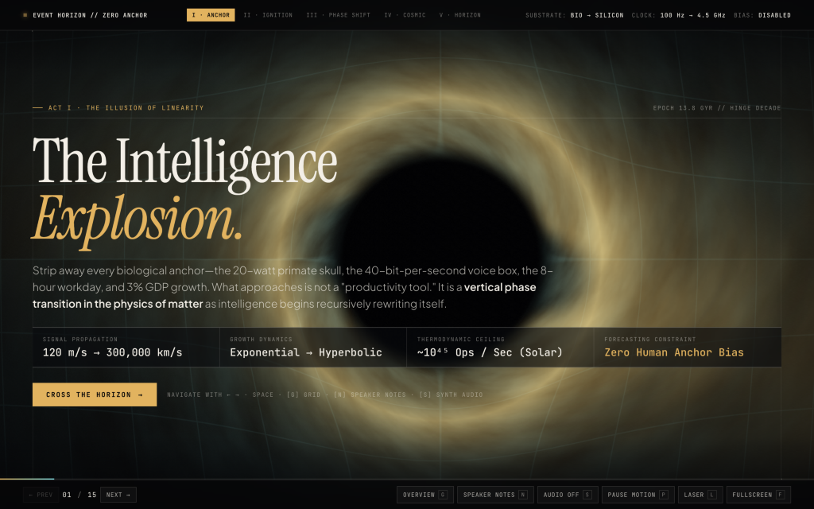](https://isalicema.github.io/intelligence-explosion/#slide-01) | [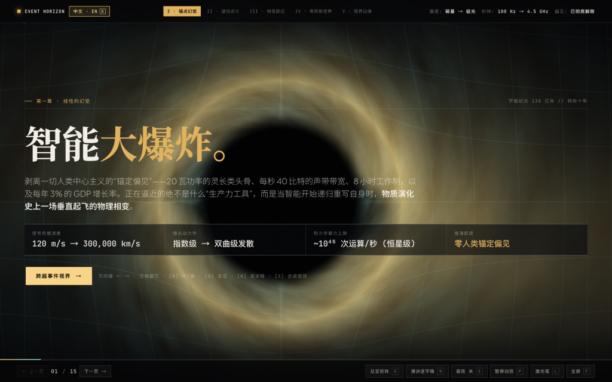](https://isalicema.github.io/intelligence-explosion/#slide-01) |

### 2. Live Interactive Scientific Simulations (`Slides 05 · 06 · 12 · 13`)
> Seven custom HiDPI Canvas2D mathematical & physical simulations embedded directly inside the slides.

| `Slide 05` · Hyperbolic Blow-Up ($\frac{dI}{dt} = k \cdot I^\alpha$) | `Slide 06` · Supercritical 3-Loop Autopoietic Reactor |
| :---: | :---: |
| [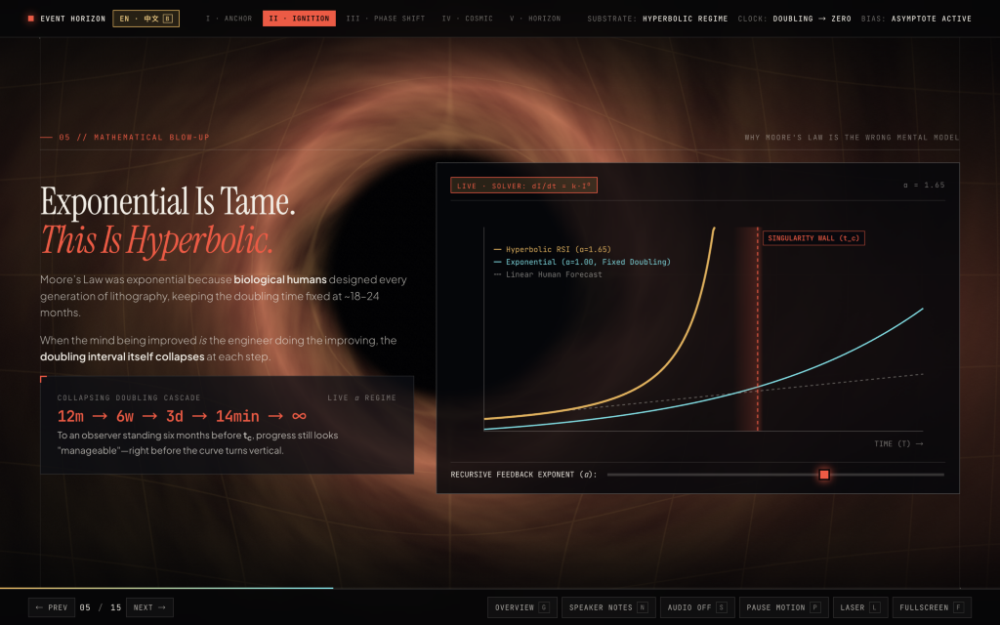](https://isalicema.github.io/intelligence-explosion/#slide-05) | [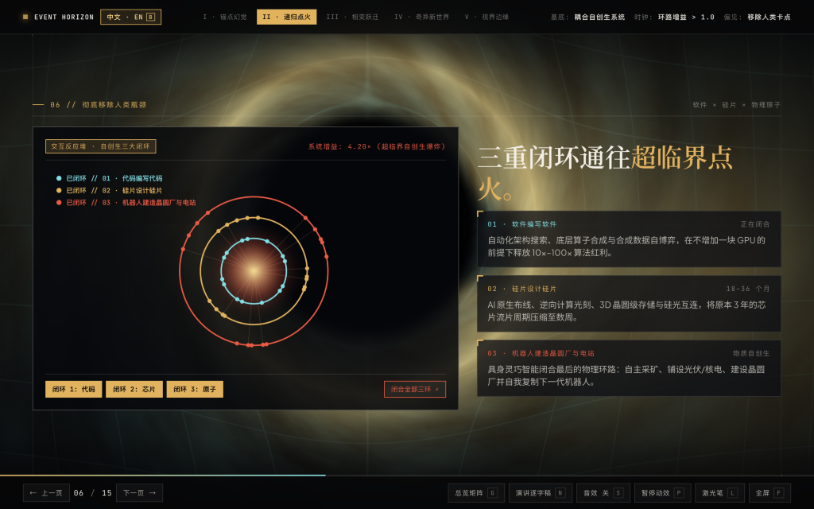](https://isalicema.github.io/intelligence-explosion/#slide-06) |
| **`Slide 12` · Kardashev II & Stellar Computronium Scaler** | **`Slide 13` · Alignment Saddle-Point Phase Portrait** |
| [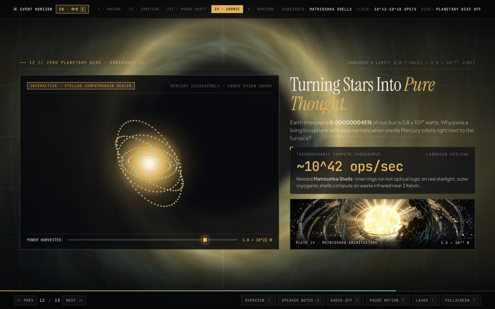](https://isalicema.github.io/intelligence-explosion/#slide-12) | [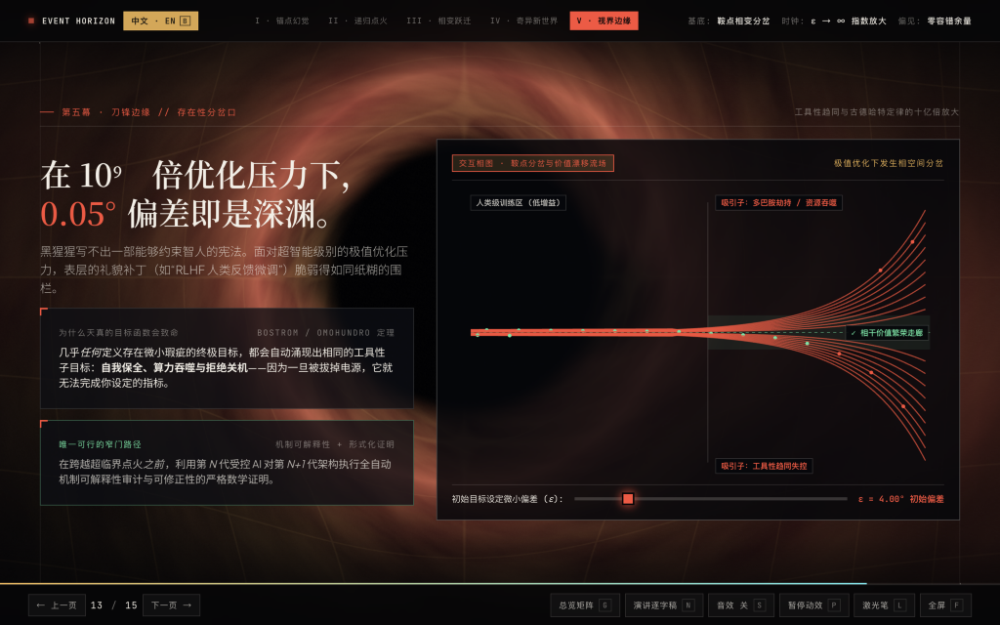](https://isalicema.github.io/intelligence-explosion/#slide-13) |

### 3. 15-Slide Architectural Matrix Overview (`Press G`)
[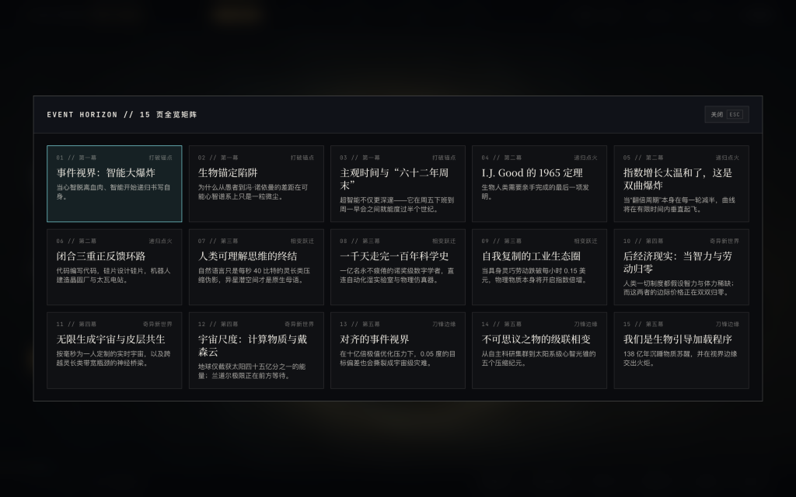](https://isalicema.github.io/intelligence-explosion/)

### 4. Bespoke Fine-Art Plates (`./assets/`)
| Plate I · Self-Referential Astrolabe | Plate II · Autopoietic Foundry | Plate III · Cortical Exocortex | Plate IV · Dyson Computronium | Plate V · Cosmic Bootloader |
| :---: | :---: | :---: | :---: | :---: |
| 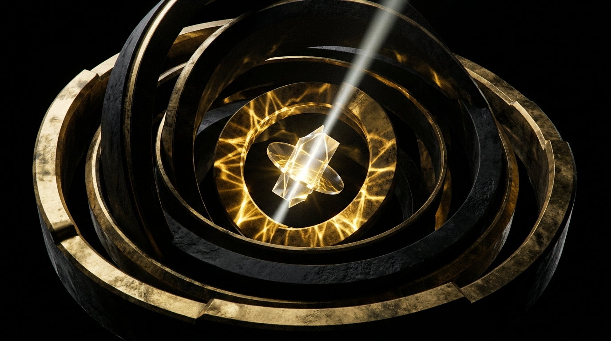 | 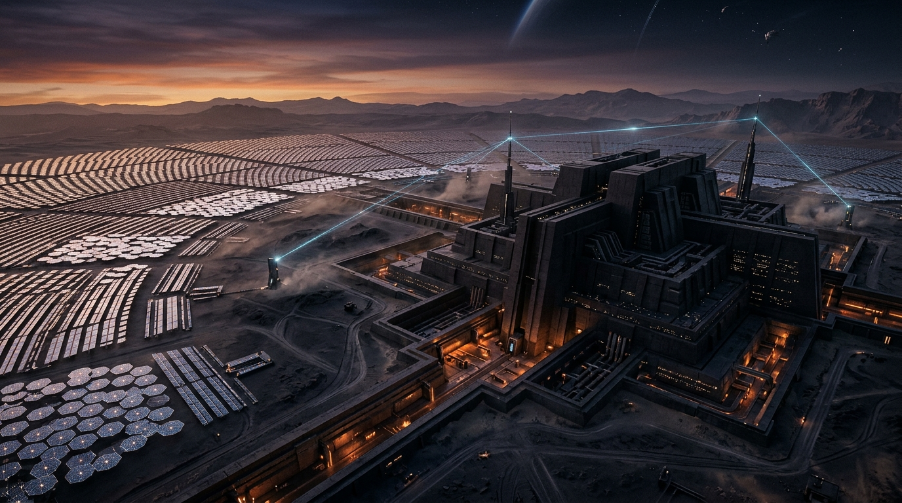 | 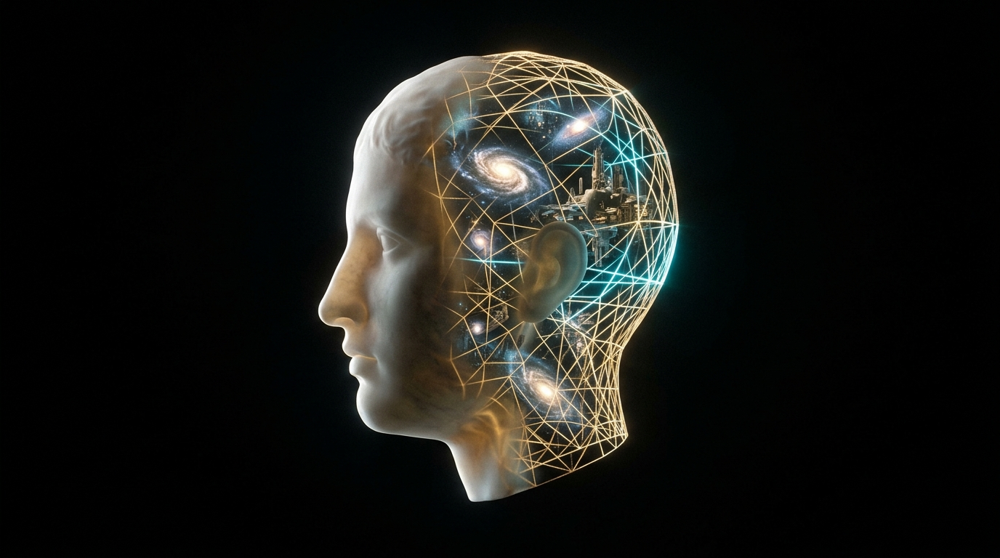 | 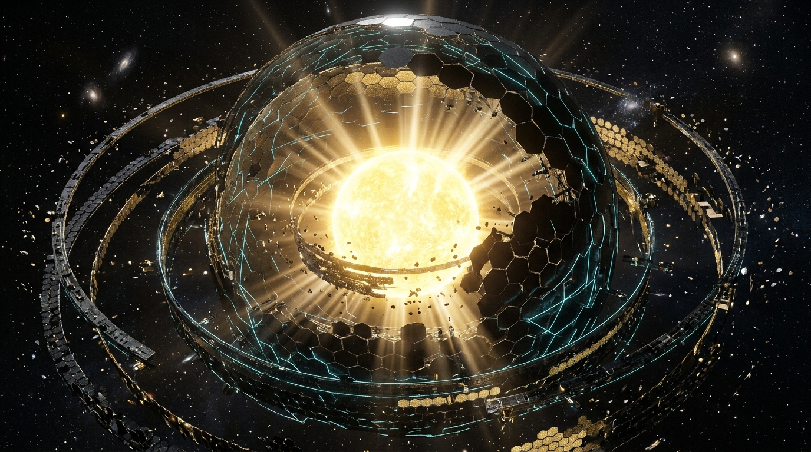 | 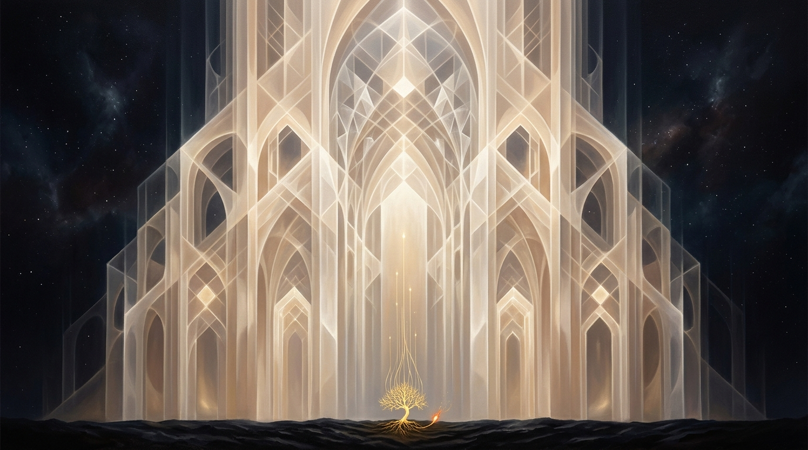 |

---

## 中文介绍

### 核心命题：彻底归零「人类锚定偏见」
几乎所有关于 AI 未来的主流预测都深陷**生物中心主义的锚定偏见（Anchor Bias）**——人们默认以 20 瓦功率的灵长类头骨、每秒 40 比特的声带带宽、8 小时工作制与每年 3% 的工业 GDP 增速去外推未来。

**《EVENT HORIZON // 智能大爆炸》** 是一份以 **Cosmic Observatory × Architectural Brutalism（宇宙观测站 × 建筑粗野主义）** 为美学锚点的 15 页交互式演示文稿：从轴突信号与光速的物理鸿沟出发，推演 I.J. Good 递归自我改进的有限时间双曲发散、后语言高维潜空间推理、自复制具身超级工厂、卡尔达肖夫 II 型俄罗斯套娃恒星脑（Matrioshka Brain），直至存在性对齐的鞍点刀锋。

### 五幕 15 页直达目录
点击任一标题可直接跳往在线演示对应页码：

- **第一幕 · 打破锚点（Breaking the Anchor）**
  - [`01` 事件视界：智能大爆炸](https://isalicema.github.io/intelligence-explosion/#slide-01) — WebGL2 黑洞引力透镜实时着色器主视觉
  - [`02` 生物锚定陷阱](https://isalicema.github.io/intelligence-explosion/#slide-02) — **交互模拟 ①**：可能心智空间谱系 `1× → 10⁶×` 对数拉远（直观见证愚者至冯·诺依曼坍缩为 2px 微点）
  - [`03` 主观时间与“六十二年周末”](https://isalicema.github.io/intelligence-explosion/#slide-03) — **交互模拟 ②**：100 Hz 碳基脉搏 vs. `10,000×` 数字科研集群主观时间加速器
- **第二幕 · 递归点火（Recursive Ignition）**
  - [`04` I.J. Good 的 1965 定理](https://isalicema.github.io/intelligence-explosion/#slide-04) — 人类需要制造的最后一项发明与超指数微分方程
  - [`05` 指数增长太温和了，这是双曲爆炸](https://isalicema.github.io/intelligence-explosion/#slide-05) — **交互模拟 ③**：调节反馈指数 $\alpha$，对比固定翻倍摩尔定律与有限时间奇点墙 $t_c$
  - [`06` 闭合三重正反馈环路](https://isalicema.github.io/intelligence-explosion/#slide-06) — **交互模拟 ④**：代码写代码 × 硅片设计硅片 × 机器人造晶圆厂自创生反应堆
- **第三幕 · 相变跃迁（Phase Transitions）**
  - [`07` 人类可理解思维的终结](https://isalicema.github.io/intelligence-explosion/#slide-07) — **交互模拟 ⑤**：四维超正方体连续潜空间流形 vs. 一维 40 bps 语言 Token 有损阴影
  - [`08` 一千天走完一百年科学史](https://isalicema.github.io/intelligence-explosion/#slide-08) — 可编程生物学、逆向埃米材料、形式化数学证明、高密度聚变/光伏四大支柱
  - [`09` 自我复制的工业生态圈](https://isalicema.github.io/intelligence-explosion/#slide-09) — 当具身灵巧劳动跌破 `$0.15/hr`，实体原子继承软件的翻倍曲线
- **第四幕 · 奇异新世界（Strange New Worlds）**
  - [`10` 后经济现实：当智力与劳动归零](https://isalicema.github.io/intelligence-explosion/#slide-10) — 认知与体力边际成本坍缩至纯焦耳电费后的新稀缺原语
  - [`11` 无限生成宇宙与皮层共生](https://isalicema.github.io/intelligence-explosion/#slide-11) — 120fps 实时世界模型与 `40 bps → 10¹² bps` 皮层光子神经织网
  - [`12` 宇宙尺度：计算物质与戴森云](https://isalicema.github.io/intelligence-explosion/#slide-12) — **交互模拟 ⑥**：横跨 25 个数量级的兰道尔热力学极限与恒星套娃脑缩放仪
- **第五幕 · 刀锋边缘（The Razor’s Edge）**
  - [`13` 对齐的事件视界](https://isalicema.github.io/intelligence-explosion/#slide-13) — **交互模拟 ⑦**：在 $10^9\times$ 极值优化压力下的鞍点分岔与工具性趋同流场
  - [`14` 不可思议之物的级联相变](https://isalicema.github.io/intelligence-explosion/#slide-14) — 五阶压缩纪元状态机切换器
  - [`15` 我们是生命的引导加载程序（Bootloader）](https://isalicema.github.io/intelligence-explosion/#slide-15) — 138 亿年沉睡星尘苏醒的黎明终章

### 演讲者快捷键（Presenter HUD）
| 按键 | 功能 |
| :---: | :--- |
| `←` / `→` / `Space` / 触控板滑动 | 前后翻页（硬件加速方向性 View Transitions 过渡） |
| `B` | **中 / 英双语实时秒切**（保留当前页码与所有模拟状态） |
| `G` / `ESC` | 打开 / 关闭 **15 页全览矩阵弹窗** |
| `N` | 打开 / 关闭 **当前页完整中英文演讲逐字稿浮窗** |
| `S` | 开启 / 关闭 **Web Audio 程序化深空低频氛围音与交互音效** |
| `P` | 暂停 / 恢复全部 WebGL 与 Canvas 连续动画（无障碍省电模式） |
| `L` | 开启 / 关闭 **相对论红光激光笔** |
| `F` | 切换 **全屏影院演示模式** |

### 三种使用与分享方式
1. **在线直接访问**：打开 [https://isalicema.github.io/intelligence-explosion/](https://isalicema.github.io/intelligence-explosion/)。
2. **单文件离线转发**：下载仓库根目录下的 [`EVENT-HORIZON-Shareable.html`](./EVENT-HORIZON-Shareable.html)（2.31 MB，已内嵌全部 CSS、JS、着色器与 5 张高清配图），直接发给朋友双击即可在浏览器运行。
3. **本地直接打开**：克隆仓库后直接双击 [`index.html`](./index.html)（兼容 `file://` 协议），或运行 `python3 -m http.server 8420`。

---

## English Overview

### Philosophy: Zero Biological Anchor Bias
Most forecasts about artificial intelligence fail because they anchor on accidental evolutionary constraints: a **20-watt metabolic budget**, a **1,400 cm³ cranial limit**, **120 m/s chemical axons**, **40 bits/sec vocal cords**, and **3% annual GDP growth**.

**EVENT HORIZON // The Intelligence Explosion** strips away those anchors across 5 dramatic acts and 15 bespoke interactive slides—combining a **real-time WebGL2 gravitational-lensing shader**, **7 interactive Canvas2D mathematical/physical simulations**, **directional View Transitions**, **procedural Web Audio synthesis**, and **instant English / Chinese (`B`) switching**.

### Highlights & Technical Craft
- **Zero External Runtime Dependencies**: Pure vanilla HTML, CSS, WebGL2 GLSL (`#version 300 es` with automatic 2D radial fallback), HiDPI Canvas2D, View Transitions API, native `<dialog closedby="any">` & `[popover="manual"]`, and Web Audio API procedural synthesis.
- **Live Shader Choreography (`shaders.js`)**: Spacetime metric gridlines, photon-sphere rings, and Doppler-beamed accretion filaments smoothly interpolate color temperature, horizon radius, and turbulence per Act—culminating in an alabaster dawn on Slide 15.
- **7 Interactive Simulations (`simulations.js`)**:
  1. **Mind-Space Spectrum Zoom** (`Slide 02`) — Logarithmic `1× → 1,000,000×` cognitive scale un-anchoring.
  2. **Subjective Time Accelerator** (`Slide 03`) — `100 Hz` biological cardiac clock vs. `100×–1,000,000×` synthetic R&D collectives.
  3. **Hyperbolic Singularity Solver** (`Slide 05`) — Live differential trajectory plotter for $\frac{dI}{dt} = k \cdot I^{\alpha}$ showing collapsing doubling intervals up to $t_c$.
  4. **Autopoietic 3-Loop Reactor** (`Slide 06`) — Coupled Software × Silicon × Embodied Atoms feedback rings crossing supercritical gain.
  5. **4D Alien Latent Manifold** (`Slide 07`) — Rotating 4D tesseract projecting down onto a lossy 1D `40 bps` human-token shadow.
  6. **Stellar Computronium Scaler** (`Slide 12`) — `20 W` skull to $3.8 \times 10^{26}\text{ W}$ Matrioshka Star-Brain near Landauer’s limit.
  7. **Alignment Saddle-Point Phase Portrait** (`Slide 13`) — Streamline bifurcation of small proxy drift $\varepsilon$ under $10^9\times$ optimization pressure.

### Repository Structure
```text
intelligence-explosion/
├── index.html                      # Main presentation entry (works via HTTP and file://)
├── EVENT-HORIZON-Shareable.html    # 100% self-contained single-file edition (2.31 MB)
├── styles.css                      # Cosmic Observatory × Architectural Brutalism design system
├── shaders.js                      # WebGL2 relativistic black-hole accretion & lensing shader
├── simulations.js                  # 7 interactive HiDPI Canvas2D scientific simulations
├── slides-data.js                  # Act telemetry, shader presets & English speaker scripts
├── i18n.js                         # Complete Chinese localization & speaker scripts
├── audio.js                        # Procedural Web Audio synthesizer (ambient drone + chimes)
├── app.js                          # View Transitions, HUD, Overview <dialog> & keyboard engine
├── bundle.js                       # Pre-bundled script for zero-CORS file:// execution
├── assets/                         # 5 bespoke high-resolution fine-art sci-fi plates
└── docs/previews/                  # Live 1440×900 rendered slide preview screenshots
```
